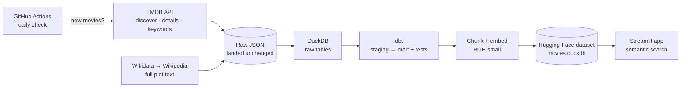

# 🎬 Find That Movie — Semantic Movie Search Pipeline

**Describe a plot in your own words, get the most likely movies.**

> *"a boy discovers he is a wizard and goes to a magic school"* → **Harry Potter and the Philosopher's Stone**

### 👉 [Try it live](https://movie-pipeline.streamlit.app/)

An end-to-end data pipeline that collects ~2,600 films (2000–2025) from TMDB, enriches them with full Wikipedia plots, models them in DuckDB with dbt, and turns every word of every plot into searchable embeddings. It refreshes itself automatically, at **$0/month**.

---

## Architecture



| Layer | Tool | What it does |
|---|---|---|
| Extract | Python, `requests` | TMDB + Wikipedia → raw JSON, partitioned by year |
| Load | DuckDB | Raw JSON → 3 raw tables in a single file, no server |
| Transform | dbt | Clean `movies` table, one row per film, with data tests |
| Embed | sentence-transformers | Plot chunks → 384-dimension vectors |
| Serve | Streamlit Community Cloud | Describe a plot → top 10 matches |
| Orchestrate | GitHub Actions | Daily check, full refresh only when needed |
| Storage | Hugging Face Datasets | Versioned database + raw archive |

---

## How it works

### 1. Extract — `extract/`
- **`fetch_discover.py`**: the top 100 most-voted films per year from TMDB `/discover/movie`, saved as `data/raw/discover/year=YYYY/page_N.json`.
- **`fetch_details.py`**: one call per film (`append_to_response=keywords,external_ids`) for keywords and the Wikidata ID.
- **`fetch_wiki_plots.py`**: Wikidata ID → exact English Wikipedia page → full text. Matching by ID instead of title avoids wrong pages for remakes and common names.

Design choices:
- **Raw data is kept unchanged.** Anything downstream can be rebuilt without calling the APIs again.
- **Idempotent.** Each file has a deterministic path and is written atomically (`.tmp` → rename), so a re-run overwrites and never duplicates.
- **Incremental.** Films already fetched are skipped.
- **Resilient.** Retries with backoff on HTTP 429, 5xx and network errors, honouring `Retry-After`. A contact User-Agent and polite pacing keep Wikipedia from rate-limiting.

### 2. Load — `load/load_raw.py`
DuckDB reads thousands of JSON files in one SQL statement (`read_text` / `read_json_auto`). Details are stored as a whole JSON column and parsed in dbt. Letting DuckDB infer a schema across 2,600 nested files ran out of memory, so the load layer stays schema-agnostic.

### 3. Transform — `transform/` (dbt)
- **`stg_details`**: typed fields plus genre and keyword lists (`json_extract_string(data, '$.genres[*].name')`).
- **`stg_wiki`**: a regex cuts the *Plot* / *Synopsis* / *Premise* section out of each Wikipedia page.
- **`movies`** (mart): one row per film, and a `search_text` built from the Wikipedia plot (falling back to the TMDB overview) plus keywords.
- **Tests:** `unique` and `not_null` on keys, titles and search text.

### 4. Embed — `search/embed.py`
- Every word counts: the text is split into **150-word chunks with a 30-word overlap**, so nothing is cut off by the model's input limit (~15,000 chunks).
- Model: **`BAAI/bge-small-en-v1.5`**, trained for short-query → long-passage retrieval. It runs on CPU.
- **Incremental:** an MD5 hash of `search_text` plus the model name tells it which films are new or changed. Only those get re-embedded.

### 5. Search — `app/streamlit_app.py`
1. Embed the description (with BGE's query prefix).
2. Compute cosine similarity against every chunk, in DuckDB.
3. Score each film by the **average of its 3 best chunks**, so one lucky paragraph can't win alone.
4. Return the top 10, with the passage that matched.

### 6. Orchestration — `.github/workflows/`
Event-driven instead of a blind schedule:

```
Daily 03:17 ─► check (~1 min): this year's TMDB list vs known_ids.json
                 ├─ nothing new ─► stop
                 └─ new films  ─► refresh: extract → load → dbt build → embed → publish
```

Expensive steps (API calls, embeddings) are incremental. Cheap steps (load, dbt) do a full rebuild, which is always correct and takes seconds at this scale.

---

## Run it locally

```bash
python -m venv .venv && .venv\Scripts\activate      # Windows
pip install -r requirements.txt
copy .env.example .env                               # add TMDB_API_KEY

python -m extract.fetch_discover
python -m extract.fetch_details
python -m extract.fetch_wiki_plots                   # ~1h, Wikipedia pacing
python -m load.load_raw
cd transform && dbt build --profiles-dir . && cd ..
python -m search.embed                               # ~8 min on CPU

streamlit run app/streamlit_app.py                   # web app
python -m search.find "your description"             # or terminal search
```

## Project structure

```
extract/      API → data/raw (TMDB, Wikipedia)
load/         raw JSON → DuckDB
transform/    dbt project (staging + mart + tests)
search/       embed.py (chunks + vectors), find.py (terminal search)
app/          Streamlit web app
scripts/      hf_sync.py (Hugging Face storage), check_new_movies.py (daily check)
.github/      GitHub Actions workflow
```

## What I'd change at scale

- **Parquet partitions** instead of one DuckDB file, so only new partitions get uploaded.
- **dbt incremental models** (`materialized='incremental'`, `unique_key`) instead of full rebuilds.
- **A vector database** (or DuckDB's `vss` HNSW index) instead of brute-force similarity.
- **Refreshing ratings** for recent films, which today are fetched once.
- **A wider catalogue.** Back to the Future (1985) isn't found yet because the data starts in 2000.

---

**Stack:** Python · SQL · DuckDB · dbt · sentence-transformers · Streamlit · GitHub Actions · Hugging Face

Built by **Oscar Meléndez** · [Portfolio](https://oscar-melendez77.github.io/portfolio.html) · [LinkedIn](https://linkedin.com/in/josueme91)

*Data from [TMDB](https://www.themoviedb.org) (this product uses the TMDB API but is not endorsed or certified by TMDB) and [Wikipedia](https://www.wikipedia.org) (CC BY-SA).*
